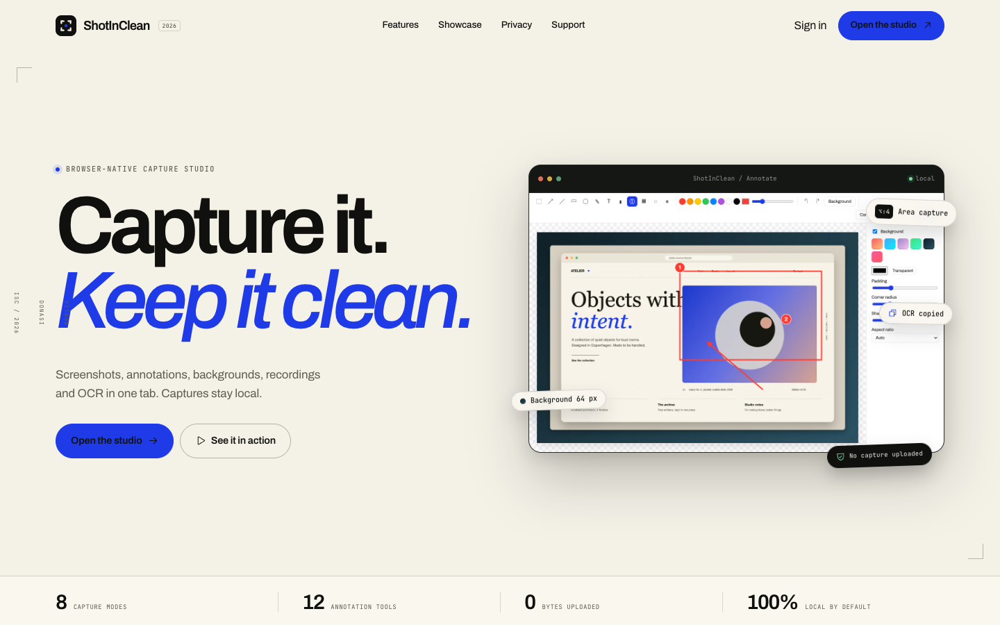
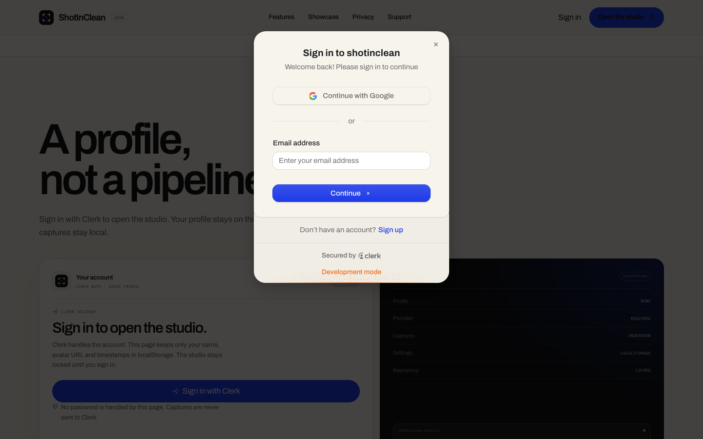
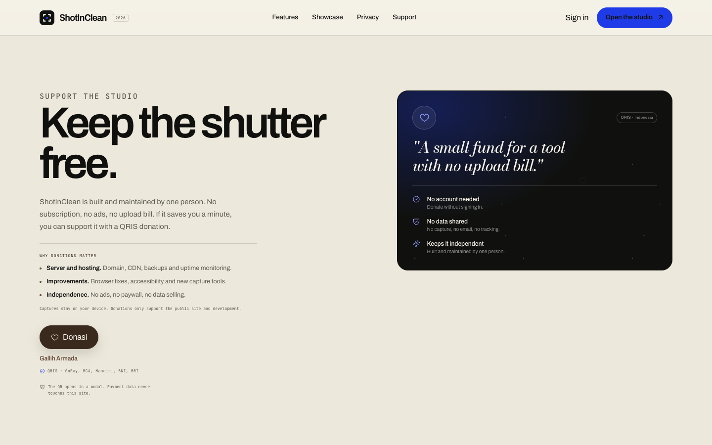
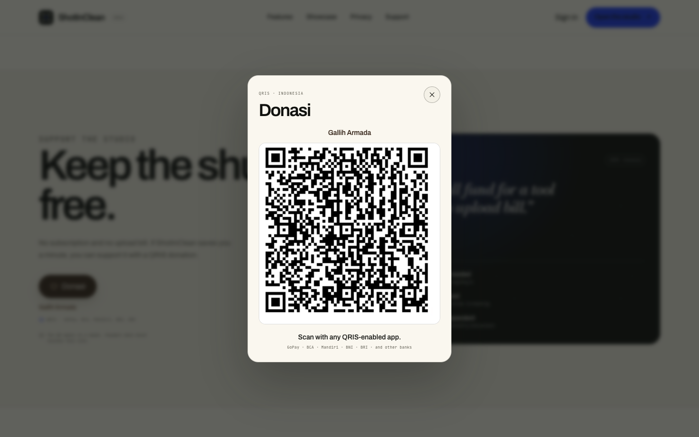

# ShotInClean

A [CleanShot X](https://cleanshot.com/)-style screenshot and screen-recording app that
runs in the browser. It is written in strict TypeScript with Vite and no UI framework.

The project now ships two surfaces:

| Route | What it is |
| --- | --- |
| `/` | The public landing page: product story, feature demos, Clerk sign-in, local profile and repository access |
| `/#/app` | The capture studio: Clerk sign-in required. Area/screen/window capture, annotation, backgrounds, recording, OCR, pin and history |



## Features

| | |
| --- | --- |
| **Capture** | Area (freeze frame, crosshair, pixel magnifier, live size), screen, window, previous area, self-timer |
| **Annotate** | Arrow, line, rectangle, ellipse, pen, text, highlighter, numbered counter, pixelate, blur, crop. Undo/redo, select & move, keyboard shortcuts |
| **Background tool** | Gradient, solid or transparent backdrop with padding, rounded corners, shadow and aspect ratio (16:9, 4:3, 1:1, 9:16) |
| **Record** | MP4 (H.264 when the browser supports it) or WebM, plus an optimized GIF export. Mic + system audio mixing, webcam bubble, pause/resume, countdown |
| **Trim** | Set in/out points and export as video or GIF (fps and width presets) |
| **Capture Text (OCR)** | Select an area and the recognized text goes to the clipboard. Runs offline (Tesseract is self-hosted) |
| **Quick Access Overlay** | A card after every capture with Annotate / Copy / Save / Pin, drag out to save, and restore-closed |
| **Pin to screen** | Always-on-top floating window via Document Picture-in-Picture. Scroll to zoom, ⌥-scroll for opacity |
| **History** | Every capture is kept in IndexedDB, scoped to the local profile |
| **Open** | From the clipboard (button or ⌘V/Ctrl+V), by drag & drop, or from a file |

The evidence behind the feature set, and the mapping from CleanShot's native design
to browser APIs, is in **[docs/RESEARCH.md](docs/RESEARCH.md)**.

## Landing page

The landing page is a hand-built editorial page with:

- a light paper and cobalt design system, oversized Archivo type and a Bodoni accent
- a split hero with the real annotation editor, live feature bento cards and a five-frame showcase
- an interactive background-tool demo, a working OCR copy button, tabs with keyboard navigation and an FAQ
- a QRIS donation modal with only the QR code, opened from the support section
- Clerk sign-in required before the studio can open
- a repository card that unlocks after sign-in
- local profile data in `localStorage` and a per-profile capture database in IndexedDB

There is no backend. The landing page stores a profile record; the studio stores
settings and media. No capture is uploaded to a server.

### Clerk setup

Clerk is required for the studio. Put a publishable key in `.env.local` (already gitignored):

```bash
VITE_CLERK_PUBLISHABLE_KEY=pk_test_your_key_here
```

Get it from the [Clerk dashboard](https://dashboard.clerk.com) under **API keys**.
The publishable key is public by design. Never put a Clerk secret key in a `VITE_`
variable or in client code. Only `VITE_` variables are exposed by Vite; a
`CLERK_SECRET_KEY` in `.env.local` stays server-side and is never bundled.

Then open the Clerk dashboard and add your origins:

- `http://localhost:5173` for `npm run dev`
- your production origin, for example `https://shotinclean.example.com`
- `http://localhost:4173` if you test with `npm run preview`

If no publishable key is present, sign-in is disabled and the studio stays locked.
The landing page itself still renders. Direct visits to `/#/app` are redirected to
the account section and the Clerk modal is opened. After sign-in, the studio opens
automatically.

When a Clerk user signs in, the client saves only this shape in localStorage:

```json
{
  "id": "user_...",
  "fullName": "Ada Lovelace",
  "email": "ada@example.com",
  "imageUrl": "https://img.clerk.com/...",
  "provider": "clerk",
  "createdAt": 1790000000000,
  "savedAt": 1790000000000,
  "lastSeenAt": 1790000000000
}
```

No session token, password or capture is written to the landing page store. Clerk
handles the session in its own cookies/storage. Captures stay in the studio's
IndexedDB database.

### Local data model

| Key or database | Contents |
| --- | --- |
| `localStorage["shotinclean.auth.v1"]` | Versioned map of local profiles plus the active user id |
| `localStorage["shotinclean.settings.<scope>"]` | Recording and screenshot preferences for that profile |
| `localStorage["shotinclean.previousArea.<scope>"]` | Last area selection for that profile |
| IndexedDB `shotinclean` | Legacy captures from before the Clerk gate |
| IndexedDB `shotinclean-<scope>` | Captures for a signed-in profile, where `<scope>` is the sanitized Clerk id |

`<scope>` comes from `profileScope()` in `src/auth/session.ts`. Media is deliberately
kept in IndexedDB instead of localStorage: localStorage is synchronous and limited to
roughly 5 MB, which is not enough for images and videos.

The landing page gives the studio the profile id, and the studio opens the matching
local database. Signing out locks the studio; the captures stay in that profile-scoped
database and return when the same Clerk user signs in again.

### Routes and hosting

The landing page is `/`. The studio is `/#/app` and requires a Clerk-backed local
profile. A direct visit without one is redirected to `#account`, where the Clerk modal
opens. Hash routing means the build works on any static host without rewrite rules.



Because this is a static app, the gate is a local session marker written only by the
Clerk listener. It is a UX gate, not a server-side security boundary. For hard access
control, host the studio on a separate origin behind Clerk middleware or verify the
session on a server.

```bash
npm run build
# serve dist/ with any static host
```

If you later move the studio to `/app`, add the host's SPA fallback and update the
`#/app` links in `src/landing/landing.ts`, `src/studio.ts` and `src/main.ts`.

## Getting started

```bash
npm install
npm run dev        # http://localhost:5173
```

Use desktop Chromium (Chrome, Edge, Arc) for the full studio feature set. Firefox and
Safari can take screenshots and record, but they lack MP4 recording in some versions,
Document PiP and `DownloadURL` drag-out.

### Shortcuts (while the studio tab is focused)

| Action | Keys | Editor tool | Key |
| --- | --- | --- | --- |
| Capture area | ⌥⇧4 | Select / arrow / line | V / A / L |
| Capture screen | ⌥⇧3 | Rect / ellipse / pen | R / O / D |
| Capture window | ⌥⇧5 | Text / highlighter / counter | T / H / N |
| Previous area | ⌥⇧6 | Pixelate / blur / crop | P / B / C |
| Self-timer | ⌥⇧7 | Undo / redo | ⌘Z / ⇧⌘Z |
| Capture text | ⌥⇧2 | Copy / save | ⌘C / ⌘S |
| Record video / GIF | ⌥⇧R / ⌥⇧G | Delete selection | ⌫ |
| Restore closed overlay | ⌥⇧Z | | |

## Scripts

| Script | What it does |
| --- | --- |
| `npm run dev` | Vite dev server |
| `npm run build` | Typecheck + production build to `dist/` |
| `npm run preview` | Serve the production build |
| `npm test` | Unit tests (Vitest): geometry, background layout, MIME selection |
| `npm run test:e2e` | Playwright end-to-end tests. Set `CHROMIUM_PATH` to use a preinstalled Chrome |
| `npm run shots` | Regenerate the marketing screenshots from the real studio (requires Vite on port 5173) |
| `npm run shots:optimize` | Convert generated PNGs to WebP (requires Python + Pillow) |
| `npm run og` | Regenerate `public/og.png` from the live landing page |

The marketing screenshot script drives the studio against a synthetic designer desktop
canvas and writes PNG shots to `src/landing/assets`. Run `npm run shots:optimize` to
convert them to WebP and remove the PNGs. The Vite watcher ignores that folder so image
generation does not reload the page mid-run.

## Donasi / QRIS

The support section has one **Donasi** button, with Gallih Armada credited above the
QRIS methods. The page explains where donations go:

- **Server and hosting:** domain, CDN, backups and uptime monitoring
- **Improvements:** browser fixes, accessibility and new capture tools
- **Independence:** no ads, no paywall, no data business

It opens a native `<dialog>` with only the QRIS QR code, cropped from the supplied
poster so the rest of the poster is not shown.



The QR is scanned with GoPay, BCA, Mandiri, BNI, BRI, or any other QRIS-enabled app.



The dialog supports backdrop click, Escape and a close button. No payment data touches
the page; the QR itself is the donation target. The image lives at
`src/landing/assets/qris.png` and is imported by the landing bundle.

## Project layout

```
src/
  main.ts        Route switch: landing or studio
  studio.ts      Capture studio shell and flows
  auth/          Local profile store shared by landing and studio
  landing/       Landing renderer, Clerk auth, icons, QRIS asset, CSS, WebP assets
  capture/       display.ts (getDisplayMedia), areaSelect.ts, recorder.ts
  editor/        editor.ts (UI + state), shapes.ts, background.ts (pure layout)
  video/         videoEditor.ts (trim UI), media.ts (GIF encode, trim, WebM duration fix)
  features/      ocr.ts, pin.ts
  ui/            quickAccess.ts, hud.ts (recording HUD, countdown), toast.ts
  store/         history.ts (IndexedDB)
  lib/           dom.ts, geometry.ts, mime.ts, ticker.ts
e2e/             Studio and landing Playwright tests
scripts/         Screenshot generation, OG image, WebP optimizer
```

## Browser limitations

A web page can't register global hotkeys, see clicks or keystrokes in other apps,
scroll other windows (no scrolling capture), or hide desktop icons. See
[docs/RESEARCH.md § Not possible in a browser](docs/RESEARCH.md#not-possible-in-a-browser)
for how an Electron or Tauri wrapper would close those gaps.

## License

ISC.
