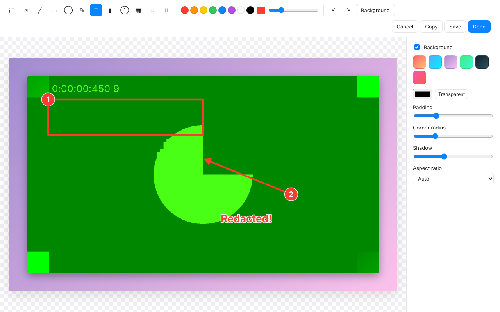

# ShotInClean

A [CleanShot X](https://cleanshot.com/)-style screenshot and screen-recording app that
runs in the browser. It's written in strict TypeScript with Vite and no UI framework.



## Features

| | |
| --- | --- |
| **Capture** | Area (freeze frame, crosshair, pixel magnifier, live size), screen, window, previous area, self-timer |
| **Annotate** | Arrow, line, rectangle, ellipse, pen, text, highlighter, numbered counter, pixelate, blur, crop. Undo/redo, select & move, keyboard shortcuts |
| **Background tool** | Gradient, solid or transparent backdrop with padding, rounded corners, shadow and aspect ratio (16:9, 4:3, 1:1, 9:16) |
| **Record** | MP4 (H.264 when the browser supports it) or WebM, plus an optimized GIF export. Mic + system audio mixing, webcam bubble, pause/resume, countdown |
| **Trim** | Set in/out points and export as video or GIF (fps and width presets) |
| **Capture Text (OCR)** | Select an area and the recognized text goes to the clipboard. Runs offline (Tesseract is self-hosted) |
| **Quick Access Overlay** | A card after every capture with Annotate / Copy / Save / Pin, drag out to save, and restore-closed |
| **Pin to screen** | Always-on-top floating window via Document Picture-in-Picture. Scroll to zoom, ⌥-scroll for opacity |
| **History** | Every capture is kept in IndexedDB |
| **Open** | From the clipboard (button or ⌘V/Ctrl+V), by drag & drop, or from a file |

The evidence behind the feature set, and the mapping from CleanShot's native design
to browser APIs, is in **[docs/RESEARCH.md](docs/RESEARCH.md)**.

## Getting started

```bash
npm install
npm run dev        # http://localhost:5173
```

Use desktop Chromium (Chrome, Edge, Arc) for the full feature set. Firefox and Safari can
take screenshots and record, but they lack MP4 recording in some versions, Document PiP
and `DownloadURL` drag-out.

### Shortcuts (while the tab is focused)

| Action | Keys | Editor tool | Key |
| --- | --- | --- | --- |
| Capture area | ⌥⇧4 | Select / arrow / line | V / A / L |
| Capture screen | ⌥⇧3 | Rect / ellipse / pen | R / O / D |
| Capture window | ⌥⇧5 | Text / highlighter / counter | T / H / N |
| Previous area | ⌥⇧6 | Pixelate / blur / crop | P / B / C |
| Self-timer | ⌥⇧7 | Undo / redo | ⌘Z / ⇧⌘Z |
| Capture text | ⌥⇧2 | Copy / save | ⌘C / ⌘S |
| Record video / GIF | ⌥⇧R / ⌥⇧G | Delete selection | ⌫ |
| Restore closed overlay | ⌥⇧Z | | |

## Scripts

| Script | What it does |
| --- | --- |
| `npm run dev` | Vite dev server |
| `npm run build` | Typecheck + production build to `dist/` |
| `npm test` | Unit tests (Vitest): geometry, background layout, MIME selection |
| `npm run test:e2e` | Playwright end-to-end tests in Chromium with a synthetic screen source and a fake webcam. Set `CHROMIUM_PATH` to use a preinstalled browser |

## Project layout

```
src/
  capture/   display.ts (getDisplayMedia), areaSelect.ts, recorder.ts
  editor/    editor.ts (UI + state), shapes.ts (model + drawing), background.ts (pure layout)
  video/     videoEditor.ts (trim UI), media.ts (GIF encode, trim, WebM duration fix)
  features/  ocr.ts, pin.ts
  ui/        quickAccess.ts, hud.ts (recording HUD, countdown), toast.ts
  store/     history.ts (IndexedDB)
  lib/       dom.ts, geometry.ts, mime.ts, ticker.ts
```

## Browser limitations

A web page can't register global hotkeys, see clicks or keystrokes in other apps,
scroll other windows (no scrolling capture), or hide desktop icons. See
[docs/RESEARCH.md § Not possible in a browser](docs/RESEARCH.md#not-possible-in-a-browser)
for how an Electron or Tauri wrapper would close those gaps.
